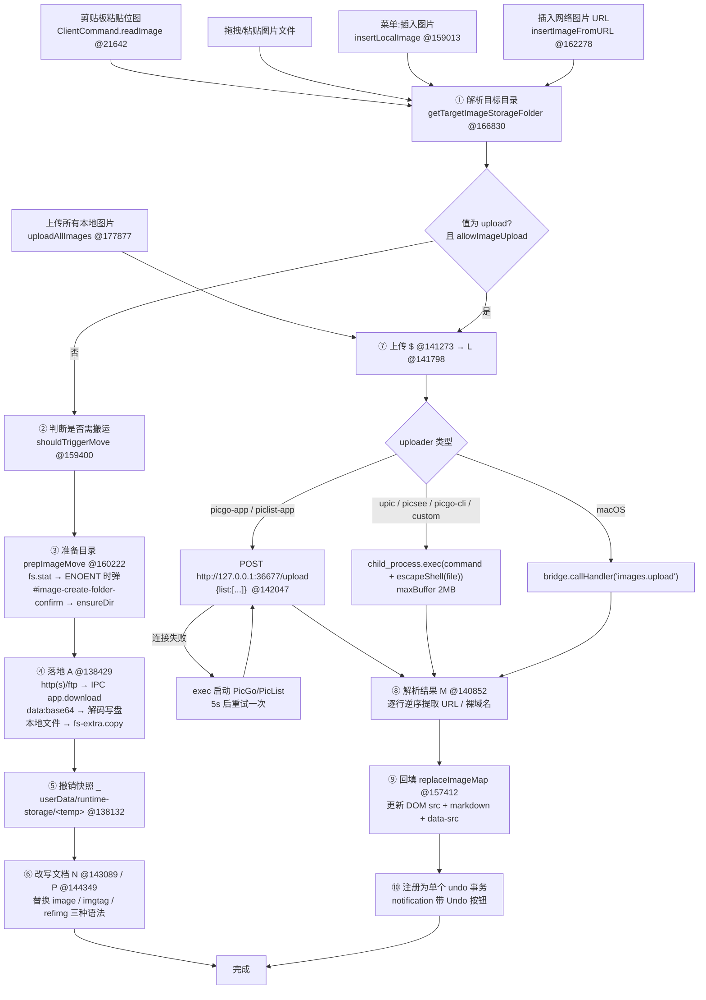

# REA 分析报告：Typora 1.9.5「图片插入 / 上传 / 图床」功能

- **分析对象**：`E:\Typor\Typor1.9.5-x64-CN\Typora`
- **分析目标功能**：图片插入、本地存储策略、图床上传、图片上下文菜单动作
- **分析日期**：本次会话
- **分析方法**：静态逆向（asar 解包、SystemJS 模块边界定位、字面量枚举、PE/Delay-Import 解析、熵分析）+ 运行时产物比对
- **结论分级约定**：
  - 🟢 **直接观察** — 从文件字节中直接读出的字面量/结构，可复现
  - 🟡 **推断** — 由多个直接观察演绎或强归纳得出，未见源码正面确认
  - 🔴 **未确认** — 静态分析无法触及，需动态调试或黑盒实验

---

## 1. 目标类型识别

### 1.1 应用类型

| 属性 | 值 | 依据（🟢 直接观察） |
|---|---|---|
| 运行时 | Electron **30.0.9** | `Typora\version` 文件内容 = `30.0.9` |
| 应用版本 | Typora **1.9.5** | `resources\package.json` → `"version": "1.9.5"` |
| 构建号 | `b20995f3` | 同上 → `"releaseId": "b20995f3"` |
| 主进程入口 | **原生 N-API 插件**，非 JS | `resources\package.json` → `"main": "main.node"` |
| 平台 | Windows x64 | `main.node` PE `machine=0x8664`；`appsrc\window\frame.js` 含 `"x64"==process.arch?"win64":"win32"` |

### 1.2 这是"三层混合"架构，而不是常规 Electron 应用

这是本次分析最重要的结构性发现，直接决定了每个结论的可验证程度：

```
┌─ 层 1：原生主进程 ──────────────────────────────────────────┐
│ resources/app.asar.unpacked/main.node                       │
│   • 1,102,720 字节 PE32+ DLL，编译时间 2024-06-20T14:20:35Z │
│   • 导出 napi_register_module_v1 / node_api_module_get_api_version_v1 │
│   • 延迟导入表中 DLL 名字面量就是 "node.exe"（51 个 napi_* 函数）│
│   🟢 直接观察：全文件仅 1708 段 ≥6 字符可打印 ASCII，且不含任何 │
│      应用语义字符串（image/upload/app./shell. 命中数均为 0）    │
│   → 应用逻辑字符串不可静态读取                                │
└──────────────────────────────────────────────────────────────┘
┌─ 层 2：加密的主进程 JS ─────────────────────────────────────┐
│ resources/app.asar / atom.js  （187,460 字节）               │
│   🟢 entropy = 6.000，可打印率 99.9989%                       │
│   🟢 base64 解码后 = 140,593 字节，entropy = 7.999（近理论上限）│
│   → 高熵密文（或压缩+加密），**非明文 JS**                     │
└──────────────────────────────────────────────────────────────┘
┌─ 层 3：渲染层（可完全静态分析）──────────────────────────────┐
│ resources/appsrc/window/frame.js  1,641,581 字符，SystemJS   │
│   • 88 个 registerDynamic 模块，模块 id 为十六进制短名         │
│ resources/window.html  91,651 字节                           │
│ resources/page-dist/**  偏好设置 / 欢迎页 React chunk         │
└──────────────────────────────────────────────────────────────┘
```

**🟡 推断（由三条直接观察演绎，置信度很高）：`main.node` 是解密加载器 + 原生能力提供者**

1. 🟢 `resources\app.asar` 内**只有 3 个条目**：`main.node`(卸载)、`atom.js`、`package.json` — asar 清单实测
2. 🟢 `package.json` 指定 `main` = `main.node`
3. 🟢 `atom.js` 是高熵密文

⟹ 主进程全部 JS 逻辑只能来自 `atom.js`，而它不可直接执行；因此 `main.node` 必须解密 `atom.js` 并通过其导入的 `napi_run_script` 求值。同时 `main.node` 导入 `napi_define_class` / `napi_wrap` / `napi_add_finalizer`，表明它还向 JS 暴露原生类。

> ⚠️ 对本报告的影响：**凡涉及层 1/层 2 内部实现细节的结论，一律降级为 🔴 未确认**。可确认的只有"契约面"（IPC 通道名、参数形状、调用时机），因为这些都写在层 3 的可读代码里。

### 1.3 目标功能所属类型

「图片插入/上传/图床」在 Typora 中是**渲染层主导、主进程辅助**的功能：

- 业务编排（决定图片去哪、改写 Markdown、撤销事务）**100% 在渲染层** `frame.js` 模块 `2e`
- 主进程只提供**原子能力**：`app.download`（下载）、`dialog.*`（选路径）、`path.*`（复制/删除）、`shell.trashItem`（回收站）
- 🟢 这是一条对重建极其有利的结论：**该功能的核心逻辑完全可静态还原**，没有被加密层遮挡

---

## 2. 相关模块清单

| # | 模块 | 位置 | 职责 | 等级 |
|---|---|---|---|---|
| M1 | SystemJS 模块 **`2e`** | `resources\appsrc\window\frame.js` 偏移 **136,682 – 183,965**（47,283 字符，依赖 `["e","13","2f","30","31","1b","28","11","32","2d","33","29","34","17"]`） | **图片功能全部业务逻辑**：`ImageEdit` 类（`t.exports=class{}` @145,148）+ 20 余个私有函数 | 🟢 |
| M2 | `ClientCommand` 门面 | 同文件 ~18,000 – 24,400 | `readImage` @21,642（读剪贴板位图）、`invoke` @~23,100（IPC 统一入口）、`putSetting`、`execForAll`、`showInFinder`、`selectFile` | 🟢 |
| M3 | SystemJS 模块 **`2d`** | 同文件 ~135,338 起 | `getImageScaleByElection(src, nativeHeight)` — 读 PNG/JPEG 文件头求像素比，供"智能缩放"菜单用 | 🟢 |
| M4 | SystemJS 模块 **`11`** | 同文件（工具库） | `absolutePathFrom`、`escapeURL`、`escapeShell`、`getRelativePath`、`normalizePath`、`file2wkfile`、`decodeFromEscapedURL` 等路径/转义工具 | 🟢 |
| M5 | 模块 `28` / `y` | 同文件 | 通知/对话框/`showNativeDialog` / `showProcessingNotification` | 🟢（调用点） |
| M6 | `window.html` | `resources\window.html` | 图片右键菜单项定义（`data-key="upload-img"` 等）、`#typora-uploading-image-templ` 上传中占位模板、`#image-create-folder-confirm` 建目录确认模态、`#switch-img-syntax-menu`、`#zoom-img-menu` | 🟢 |
| M7 | 偏好设置 UI | `resources\page-dist\static\js\Preferences.962926a4.bc0c6841.chunk.js` | 图片设置项渲染与写回（`keyName:"image_save_location"` @~38,949） | 🟢 |
| M8 | 原生插件 | `resources\app.asar.unpacked\main.node` | 解密加载器 + 原生能力（下载、对话框、文件系统、回收站） | 🔴 内部实现未确认；契约面 🟢 |
| M9 | 加密主进程 JS | `resources\app.asar` 内 `atom.js` | 主进程业务编排（含 IPC 处理实现） | 🔴 不可读 |
| M10 | `lib.asar` → `jimp/browser/lib/jimp.min.js` | 433,965 字节 | 浏览器端图像处理库，随包分发 | 🟢 存在；🔴 **是否被图片管线调用未确认**（`frame.js` 模块 `2e` 内未出现 `jimp` 调用点） |
| M11 | `node_modules.asar` → `electron-dl`、`fs-plus`、`jschardet`、`iconv-lite` | 2930 个文件 | 下载、文件系统扩展、编码探测（供主进程用） | 🟢 存在；🔴 具体调用点未确认 |

---

## 3. 处理步骤（端到端数据流）

### 3.0 总览



### 3.1 ① 目标目录解析 — 全功能的"决策中枢"

`getTargetImageStorageFolder(ignoreSetting, forceUpload)` @**166,830**：

```
1. 若是 TextBundle / TextPack  → <bundle>/assets        （assetsFolderForTextBundle @166,4xx）
2. 读文档级本地设置 c = "typora-copy-images-to"          🟢 @137,028 定义
     editor.localSettingBridge.getSetting(c)
3. 若为源码模式 → 跳过文档级设置
4. 若 (allowImageUpload || forceUpload) 且值 ∈ {ipic, upload}（忽略大小写）→ 返回 "upload"
5. 否则 resolve(当前文档目录, 值) 并 normalizePath
6. 无文档级设置 → 回退 getTargetImageStorageFolderFromSetting() @167,462
```

回退链 `getTargetImageStorageFolderFromSetting()` @**167,462**，读取全局 `File.option.defaultImageStorage`：

| 值 | 语义 | 结果目录 |
|---|---|---|
| `""` / `null` | No special action | 不动（图留在原地） |
| `folder` | Copy image to current folder | `<docdir>` |
| `assert` | Copy image to ./assets | `<docdir>/assets` |
| `per-file-assert` | Copy image to ./${filename}.assets | `<docdir>/<name>.assets` |
| `ipic` / `upload` | Upload image | `"upload"` 哨兵值 |
| `custom` | Copy image to custom folder | `custom_image_save_location`，默认 `./${filename}`，支持 `${filename}` 占位符替换 |
| 其它非 "upload" 字符串 | — | 含 `${filename}` 则替换；绝对路径则直接用；否则相对文档目录 |

🟢 依据：`frame.js` @167,462–168,578 全函数已还原；`Preferences` chunk @~38,949 给出 `image_save_location` 的六个选项字面量与之**逐一对应**。

🟢 `cachedFileImageStorage` 为缓存字段；`getTargetImageStorageFolder(!0)` 表示"忽略文档级设置"。

### 3.2 ② 搬运触发判定

`shouldTriggerMove(src, target)` @**159,400**：

- 远程 URL → 由 `File.option.applyImageMoveForWeb` 决定（默认 🟢 `false`）
- 本地路径 → 由 `File.option.applyImageMoveForLocal` 决定（默认 🟢 **`true`**）
- `data:` URI 一律不搬运
- 图片已在目标目录内（且路径不含额外分隔符）→ 不搬运
- 目标为 `"upload"` 且全局设置不是 upload → 需 `checkAutoUploadIsAllowed()` @181,501 通过

🟢 默认值依据：`frame.js` @~568,700 的 options 默认对象字面量 —— `applyImageMoveForLocal:!0`、`applyImageMoveForWeb:!1`、`defaultImageStorage:null`。

`checkAutoUploadIsAllowed(interactive, silent)` @**181,501**：若 `allowImageUpload` 为假，弹原生对话框引导用户去偏好设置，并支持"不再提示"复选框，写入 `noWarnigUploadDisabled`（🟢 注意：**这是 Typora 的真实拼写错误，键名就是 `noWarnig`**）。

### 3.3 ③ 目录准备

`prepImageMove(folder, silent)` @**160,222**：

- macOS → `bridge.callHandler("images.prepImageMove", {folder, silent})`
- Windows/Linux → `fs-extra.stat(folder)`
  - 存在 → 继续
  - `ENOENT` → 弹出 `#image-create-folder-confirm` 模态（🟢 `window.html` 文案原文："Typora are trying copy the newly inserted image to folder ... **according to your YAML Front Matter setting**. But the target folder does not exist, create it now?"），置 `File.isLocked = true` 阻断编辑
  - 用户确认 → `fs-extra.ensureDir(folder)`
  - 其它错误 → 直接抛出

> 🟢 这条模态文案是「文档级配置存在」的**独立第三方证据**，与 `c="typora-copy-images-to"` 的代码证据互相印证。

### 3.4 ④ 图片落地：三种来源三条路径

函数 `A(dom, targetFolder, src, fileNameDefined, ignoreAlert)` @**138,429**：

| 来源 | 判定 | 落地方式 |
|---|---|---|
| `http(s)://` / `ftp://` | 正则 @138,7xx | `JSBridge.invoke("app.download", url, dir, name)` → 主进程下载；再按返回的 `type` 里 `image/xxx` 修正扩展名，必要时 `fs.rename` |
| `data:image/...;base64,` | 正则 @138,7xx | `decodeURI` → `fs-extra.writeFile(path, data, "base64")`；文件名 = `Date.toUTCString()` 去尾 4 字符 + "." + 子类型 |
| 本地文件路径 | 其它 | `fs-extra.copy(src, dst, {overwrite:false})` |

- **重名处理**：`uniqueFilePathOnNode`（`T`）生成不冲突路径；`window.imageDownloadMap` 防止同一 URL 重复下载（🟢 @145,067）
- **失败提示**：`"Failed to copy image\n." + err.message`；`"Image src is not a file"`（🟢 字面量原文）
- macOS 走 `bridge.callHandler("images.copyImage", {src, folder, fileNameDefined, ignoreAlert})`

### 3.5 ⑤ 撤销快照

函数 `_ (src)` @**138,1xx**：

- 把原图复制到 `File.option.userDataPath + "/runtime-storage/" + <tempString>`（🟢 `"runtime-storage"` @138,132）
- Windows 用 `fs-extra.copy`；macOS 用 `JSBridge.invoke("path.copyFile", {from,to})`
- 返回临时路径，作为 undo 的"恢复源"

撤销/重做通过 `a.recordMediaMoves()` + `undo.push({type:"deleteMedia", from})` / `redo.unshift({type:"restoreMedia", from, to})` 表达（🟢 @~139,3xx 函数 `D`）。

### 3.6 ⑥ 文档改写：三种图片语法并存

改写由 `N(dom, newSrc, isBundle)` @**143,089** 统一编排，按 `md-inline` 属性分派：

| `md-inline` | 语法 | 改写函数 |
|---|---|---|
| `image` | `` | `F` @~138,3xx（正则替换 `](...)` 内的 URL，保留 title） |
| `imgtag` | `` | `S` @~138,3xx（`src=` 属性替换，兼容单双引号与无引号） |
| `refimg` | `![alt][ref]` | 解析引用定义节点、改写 `link_list` 中对应节点的 `href` |

- 采用 **textContent 整体替换 + undo 命令区间修正**，并对比 `comparePoint` 校准选区偏移（🟢 @143,089 起）
- 每条改写都 push 到同一个 undo 事务，实现"粘贴图片 = 一次 Ctrl+Z 可撤销"

### 3.7 ⑦ 上传：委托给外部程序，而非内置图床

入口 `uploadAction(dom, skipScroll)` @**175,768** → 校验 `validateBeforeUpload()` @175,575（先 `quickUploadValidation()` @175,300，macOS 上 `ipic` 还要过 `images.iPicValidateBeforeUpload`）→ `$` @**141,273** → `L` @**141,798**。

`getImageUploaderCommand(id)` @**165,442** 的内置命令表（🟢 完整字面量）：

| id | 解析出的命令 |
|---|---|
| `ipic` | 哨兵 `"ipic"`（macOS 专用，走原生 bridge） |
| `picgo-app` | 哨兵 `"picgo-app"`（走本地 HTTP） |
| `piclist-app` | 哨兵 `"piclist-app"`（走本地 HTTP） |
| `upic` | `/Applications/uPic.app/Contents/MacOS/uPic -o url -u` |
| `picsee` | `/Applications/Picsee.app/Contents/MacOS/Picsee -u` |
| `picgo-cli` | `<userDataPath>/picgo/{win64\|win32\|linux}/picgo{.exe} u`；Windows 前缀 `chcp 65001\|` |
| `custom` | `File.option.customImageUploader`，支持 `${filepath}` `${filename}` 占位符 |

**执行路径（Windows/Linux）**：

1. **PicGo/PicList app 模式**：`fetch("http://127.0.0.1:36677/upload", {method:"POST", body: JSON.stringify({list:[...]})})`（🟢 @142,047）
   - 200 → `res.json()` → `{success, result}`
   - 失败 → `child_process.exec` 启动配置的 PicGo/PicList 可执行文件，**5 秒后重试一次**（🟢 `setTimeout(...,5e3)` @142,1xx）
   - 未配置路径 → 直接 reject：`"请在偏好设置中配置 PicGo (app) 的路径。"`（🟢 中文硬编码）
2. **CLI 模式**：`child_process.exec(command + " " + escapeShell(file), {maxBuffer: 2097152})`（🟢 2 MiB 上限）
3. **macOS**：`bridge.callHandler("images.upload", {command, file})`

**🟡 安全观察（推断）**：`custom` 上传器把用户配置的命令模板直接交给 `exec`，只对文件路径做了 `escapeShell`。命令模板本身是配置面，属于设计上的信任边界；重建时若配置可能来自不受信来源（如随仓库分发的 `.editorconfig` 式配置），则构成命令注入面。

### 3.8 ⑧ 上传结果解析：为兼容各种 CLI 的"启发式"

`M(stdout, uploader)` @**140,852**：

- `picgo-app` / `piclist-app`：直接 `JSON.parse`，取 `success ? result : []`
- 其它：**从最后一行往前扫**（`for r = lines.length-1; r >= 0; r--`），
  - 匹配 `^(https?|ftp|file)://` → 原样收
  - 匹配 `^[a-z0-9]+([-.][a-z0-9]+)*\.[a-z]{2,5}/.*$`（裸域名+路径）→ 补 `http://`
  - 一旦已收集到 URL 又遇到非 URL 行 → **立即停止**（认为是日志头）
- 同时 `console.sendLog("[Upload Result] " + stdout)`（🟢 日志埋点）

结果数量校验：`t.length == o.length` 否则报 `"fail to parse result image path from: " + stdout`。

### 3.9 ⑨ 回填

`replaceImageMap(map, isSuccess, message, uploader)` @**157,412**：

- 遍历 `B`（`buildImageMap` @156,818 建立的 `绝对路径 → [DOM...]` 映射）
- 对每个 DOM：更新 `img.src`、`data-src`；`v.fromExternalPath()` 命中则转 `wkfile://`
- 同步改写 markdown 文本（三种语法同上）
- 全部操作汇入**一个** undo 命令，完成后弹通知：
  - 全成功：`"Successfully uploaded {0} images."` + Undo 按钮
  - 部分失败：`"Successfully uploaded {0} images, {1} failed."` + 截断后的原始输出
  - 全失败：`showError()` → `"Failed to upload image. Error Message: <code>..."` + Learn More 链到 `https://support.typora.io/Upload-Image/`（CN 镜像切 `typoraio.cn`）

### 3.10 ⑩ 状态可视化的 DOM 契约

- `applyUploadingStyle` @**138,461** / `removeUploadingStyle` @**145,283**（模块 `2e` 导出为类方法，另有一个全局实现 `k` @~906,680）
- 类名状态机（🟢 @906,680 与 @902,199）：
  - `md-on-uploading` / `md-on-moving` + `md-img-loaded`
  - 注入 `#typora-uploading-image-templ` 的内容（🟢 模板原文：`.md-image-uploading-mask-wrapper > .md-image-uploading-mask > .md-image-uploading-label + 3× .uploading-line`）
  - `data-origin-path` 记录原路径
  - 延迟 1 秒才显示遮罩（避免小图闪烁）
- 失败：`md-img-error`、移出 `md-img-loaded`、清空 `uploadImageQueue` / `moveImageQueue` 条目、置 `onerror = null`（防重试风暴）
- 全局队列：`window.uploadImageQueue` / `window.moveImageQueue`（`Set`）、`window.imageDownloadMap`、`window.imgLastModified`（🟢 @144,980–145,148）

### 3.11 其余图片动作（上下文菜单）

菜单项由 `contextMenuItems(imgElem)` @**178,355** 动态拼装，顺序敏感（依据 🟢）：

1. `revealImgInFinder` / `revealImgInBrowser`（本地 vs http）
2. `copyImgToTarget-<folder>` / `moveImgToTarget-<folder>`（可变标签）
3. `uploadImg` —— 目标为 upload 时 `unshift`（置顶），否则 push
4. `copyImg`
5. `zoomImgTo-<percent>`（当 `data-pixel-ratio != 1`）
6. `zoomImg`、`imgSyntaxMarkdown` / `imgSyntaxHTML`、`deleteImgFile` / `deleteImg`

🟢 `window.html` 中对应的 `data-key` 全集（实测枚举）：
`select-img-target`、`select-img-target-move`、`delete-img`、`delete-img-file`、`upload-img`、`copy-img-to-target`、`move-img-to-target`、`copy-img`、`reveal-img-in-finder`、`reveal-img-in-browser`、`zoom-img`、`zoom-img-to-factor`、`switch-img-syntax`、`switch-img-syntax-html`、`switch-img-syntax-markdown`、`copy_as_image`

各动作实现偏移（`frame.js`）：

| 方法 | 偏移 | 要点 |
|---|---|---|
| `insertLocalImage` | 159,013 | `dialog.showOpenDialog`，过滤器扩展名 🟢 `png/jpg/jpeg/bmp/svg/tiff/webp/gif`，`multiSelections` |
| `insertImageFromURL` | 162,278 | 生成 alt（去扩展名）、决定前后空格、写 markdown、再按策略触发搬运/上传 |
| `deleteImageAction` | 171,122 | 先删文档内容，再 `shell.trashItem`（🟢 进回收站而非永久删除）；可选删除原文件，带 `noWarningForDeleteImage` 确认 |
| `copyToSelectedFolderAction` | 171,832 | `dialog.showSaveDialog`（标题 `"Copy and update image source to…"`）/ macOS `images.selectImageSavePath` |
| `copyToTargetFolderAction` | 172,696 | 复制或移动到目标存储目录 |
| `switchPattern` | 173,163 | `image` ↔ `imgtag` 语法互转；HTML→MD 时若有 `src/title/alt` 之外的属性则**拒绝转换** |
| `addStyle` | 174,385 | 改写 `style` 属性（用于 zoom）；无 style 则注入 |
| `zoomAction` | 175,207 | 写 `style="zoom:...%"`，`100%` 时清空 |
| `afterUserInsertImage` | 179,372 | 插入后自动弹上下文菜单；计算 `data-pixel-ratio` 决定是否提供"Zoom Image to %@" |
| `_copyAllImages` | 176,464 | 批量复制；`B` 映射 + 逐个 `A` + 统一 undo + `"Images copied to %@."` 通知 |
| `copyAllImages` / `moveAllImages` | 177,490 / 177,438 | 选容器目录（`openDirectory` + `createDirectory`） |
| `toggleUploadForFile` | 181,274 | 切换当前文档的"上传"模式（无则设，有则删） |
| `toggleCopyToFolder` | 182,337 | 选目录并写文档级设置；文档未保存则弹 `"Document must be saved first."` |
| `toggleUseImageRootPath` | 183,181 | 切换 `typora-root-url` |
| `doSetImageCopyToFolder` | 183,624 | `docMenu.writeProperty(c, getRelativePath(docdir, folder))`；`t=true` 时写 `"upload"` |
| `doSetImageRootPath` | 183,757 | `docMenu.writeProperty("typora-root-url", ...)` |
| `doRemoveImageCopyToFolder` | 183,885 | `docMenu.removeProperty(c)` |
| `copyImage` | 170,429 | 写剪贴板：同时写 `text`(URL)、`html`()、`image`(nativeImage)；GIF 走 `toBitmap()` |
| `revealInFinder` | 170,243 | 本地 → `shell.showItemInFolder`；远程 → `shell.openExternal` |
| `moveToTextbundleByNode` | 168,578 | 迁入 TextBundle 的 `assets/`，并清理孤立图片 |
| `onFileMoved` | 169,239 | 文档改名/移动后询问是否同步图片引用，并删除空目录（`shell.removeIfEmpty`） |
| `registerBridge` | 147,822（7 处调用） | **仅 macOS**：注册 12 个 `images.*` 回调（`images.insertImage`、`images.zoomImage`、`images.switchSyntax`、`images.copyAllImages` 等） |

---

## 4. 数据去向（Data Destinations）

| # | 去向 | 形态 | 触发条件 | 证据 |
|---|---|---|---|---|
| D1 | **文档 YAML Front Matter** | `typora-copy-images-to: <相对路径 或 "upload">` | 用户点"设为图片文件夹"/"上传此文件图片" | 🟢 `doSetImageCopyToFolder` @183,624；键名 `c"typora-copy-images-to"` @137,028 |
| D2 | **文档 YAML Front Matter** | `typora-root-url: <相对路径>` | 用户设"图片根目录" | 🟢 `doSetImageRootPath` @183,757 |
| D3 | `%APPDATA%\Typora\typora-user-images\` | `image-<DateToNumberString>.png` | **无文档级设置且无全局设置时，剪贴板位图的默认落点** | 🟢 代码 @21,975（`r&&"upload"!=r\|\|(r=_options.userDataPath+"/typora-user-images")`）+ 命名 @22,077；**🟢 运行时实测存在 5 个文件**：`image-20250908213433583.png`、`image-20250908213439557.png`、`image-20250908213532907.png`、`image-20250908213602098.png`、`image-20250920172919239.png` |
| D4 | `<文档目录>` | 图片副本 | `defaultImageStorage = "folder"` | 🟢 `getTargetImageStorageFolderFromSetting` @167,462 |
| D5 | `<文档目录>\assets\` | 图片副本 | `defaultImageStorage = "assert"` | 🟢 同上 |
| D6 | `<文档目录>\<文件名>.assets\` | 图片副本 | `defaultImageStorage = "per-file-assert"` | 🟢 同上 |
| D7 | `custom_image_save_location` 指定目录（默认 `./${filename}`） | 图片副本 | `defaultImageStorage = "custom"` | 🟢 同上 + Preferences @~38,949 |
| D8 | `<doc>.textbundle\assets\` / TextPack 内 assets | 图片副本 | 文档为 TextBundle/TextPack | 🟢 `assetsFolderForTextBundle` @~166,4xx |
| D9 | `%APPDATA%\Typora\runtime-storage\<temp>\` | **撤销快照副本** | 每次搬运/删除前 | 🟢 `"runtime-storage"` @138,132 |
| D10 | **远端图床** | HTTP/CLI 外部程序 | 用户配置上传器后 | 🟢 无内置图床 SDK；唯一内置 HTTP 端点是 `http://127.0.0.1:36677/upload` @142,047 |
| D11 | `%APPDATA%\Typora\conf\conf.user.json` | 全局选项 JSON | 偏好设置/确认框勾选"不再提示" | 🟢 `JSBridge.putSetting(k,v)` → `"setting.put"`；Preferences 用 `execCommand("File.option.X=...")` @~119,618 与 `evaluateInHost` @~122,397 |
| D12 | `%APPDATA%\Typora\typora.log` / `typora-old.log` | 文本日志 | 上传结果、exec 错误 | 🟢 `console.sendLog("[Upload Result] "+stdout)` @140,852；`console.warn("exec error: "+e)` |
| D13 | 系统回收站 | 被删除的图片 | 删除图片文件 | 🟢 `JSBridge.invoke("shell.trashItem", path)` @153,032 |
| D14 | 系统剪贴板 | text + html + nativeImage 三格式 | "复制图片" | 🟢 `copyImage` @170,429 |

> **🟢 重要结论：Typora 自身不实现任何云端图床。** `frame.js` 全文件去重后共 **26** 个硬编码 URL（可复现：`rea\tools\counts.mjs`），与图片相关的只有 `http://127.0.0.1:36677/upload`。上传一律**委托给外部进程**（PicGo/PicList/uPic/Picsee/自定义命令）。这既是设计选择，也是它能把图床支持面做得极宽的原因。

---

## 5. 配置层（完整键空间）

### 5.1 全局选项（`conf.user.json` ← Preferences UI）

🟢 从 `Preferences.*.chunk.js` 枚举的图片相关 key → `File.option.*` 映射：

| Preferences key | 目标 | 说明 |
|---|---|---|
| `image_save_location` | `File.option.defaultImageStorage` | 六选项见 §3.1 |
| `custom_image_save_location` | `File.option.customImageSaveLocation` | 🟡 键名由命名惯例推断（`frame.js` 中未见该字面量，Preferences 只写 `custom_image_save_location`） |
| `image_uploader` | `File.option.imageUploader` | 🟢 `execCommand("File.option.imageUploader = "+JSON.stringify(t)+";")` @~122,397 |
| `custom_image_uploader` | `File.option.customImageUploader` | 🟢 同上 |
| `picgo_app_path` | `File.option.picgoAppPath` | 🟢 Preferences @~119,618 |
| `piclistAppPath` | `File.option.piclistAppPath` | 🟢 同上 |
| `allow_image_upload` | `File.option.allowImageUpload` | 🟢 由 `checkAutoUploadIsAllowed` @181,501 消费 |
| `apply_image_move_for_web` / `no_image_move_for_local` | `File.option.applyImageMoveForWeb` / `applyImageMoveForLocal` | 🟢 由 `shouldTriggerMove` @159,400 消费 |
| `autoEscapeImageURL` | `File.option.autoEscapeImageURL` | 🟢 `resolveImagePath` @164,531 |
| `noWarningForDeleteImage` / `noWarningForMoveImage` / `noWarningForUpdateImageReference` | 对应确认框抑制位 | 🟢 `shouldContinue` @171,561 以**变量键名**读取 `File.option[t]` |
| `noWarnigUploadDisabled` | 同上（**保留 Typora 的拼写错误**） | 🟢 @181,596 |
| `pass_upload_confirm` | — | 🔴 仅见于 Preferences chunk，`frame.js` 中无消费点 |
| `testImageUploader` | — | 🔴 仅见于 Preferences chunk（"测试上传器"按钮），实现应在加密层或由 `execCommand` 直接驱动 |
| `setting.doDownloadPicgo` | — | 🔴 仅见于 Preferences chunk（内置下载 PicGo），实现不可见 |

### 5.2 文档级选项（YAML Front Matter ← 编辑器内设置）

| 键 | 写入者 | 读取者 |
|---|---|---|
| `typora-copy-images-to` | `doSetImageCopyToFolder` @183,624 / `doRemoveImageCopyToFolder` @183,885 | `getTargetImageStorageFolder` @166,830、`isFixedImageStorageFolder` @166,426 |
| `typora-root-url` | `doSetImageRootPath` @183,757 | `getLocalRootUrlForInsert` @~146,2xx、`resolveImagePath` @164,531、`updateLocalRootUrl` @~154,9xx |

🟢 `localSettingBridge.getSetting(key)` 是读取通道；`docMenu.writeProperty/removeProperty` 是写入通道。

### 5.3 可观测的默认值

🟢 `frame.js` @~568,700 的 options 默认对象：

```
defaultImageStorage: null,        // → "无特殊动作"，剪贴板图落 typora-user-images
applyImageMoveForWeb: false,      // 网络图默认不搬到本地
applyImageMoveForLocal: true,     // 本地图默认搬
```

🟢 本机实测 `%APPDATA%\Typora\conf\conf.user.json` **仍是出厂默认**，不含任何 `image*` 键 → 说明用户从未改动图片设置，`typora-user-images` 中的 5 个文件正是 `defaultImageStorage = null` 路径的产物，与代码推断完全吻合。

---

## 6. 主进程契约面（IPC 通道）

🟢 从 `frame.js` 全量枚举 `JSBridge.invoke("...")`（91 个通道），图片功能用到的子集：

| 通道 | 用途 | 调用点 |
|---|---|---|
| `app.download` | 下载远程图片到指定目录，返回 `{path, state, type}` | 138,7xx（🟢 `"app.download"` 也出现在 `main.node` 中？—— 否，见下） |
| `dialog.showOpenDialog` | 选图片 / 选容器目录 | 159,013 / 177,490 / 182,337 / 183,181 |
| `dialog.showSaveDialog` | "复制并更新图片源到…" | 172,461 |
| `dialog.showMessageBox` | "文档需先保存" | 182,337 |
| `images.selectImageSavePath` | macOS 专用保存面板 | 172,300 |
| `path.copyFile` / `path.moveFile` / `path.delete` | 撤销快照、移动、删除 | 138,387 / 1,245,480 / — |
| `shell.trashItem` | 删除到回收站 | 153,032 |
| `shell.isFolder` / `shell.removeIfEmpty` | 目录判定 / 清空目录 | 169,704 / 170,214 |
| `shell.showItemInFolder` / `shell.openExternal` | 在文件管理器/浏览器中显示 | `revealInFinder` @170,243 |
| `webContents.clearCache` | 重载全部图片缓存 | 155,247 |
| `clipboard.write` / `clipboard.writeImage` | 复制图片 | 170,429 |
| `image.saveSVG` / `image.saveSVGDialog` | SVG 图片保存 | 1,245,976 |
| `setting.put` | 持久化选项 | `JSBridge.putSetting` |
| `executeJavaScript` / `execForAll` | 向所有窗口广播 `File.option.X = ...` | 21,975 附近 + `checkAutoUploadIsAllowed` |

🔴 **未确认**：这些通道中哪些由 `main.node` 的原生代码实现、哪些由 `atom.js` 的加密 JS 实现。`main.node` 的可读字符串中 `"app.download"`、`"showOpenDialog"`、`"trashItem"` **均无命中**（已实测），因此通道名的字符串表在加密层或经运行时构造。

> 🟡 一条值得注意的观察：`main.node` 的延迟导入表把宿主 DLL 名字面量写作 **`"node.exe"`**（而非 `Typora.exe`）。推测其构建时按 Node.js 原生插件方式链接，运行时由 Electron 主进程提供同名导出。重建时若要做同类插件，需注意宿主可执行文件名匹配问题。

---

## 7. 证据分级汇总

### 🟢 直接观察（可复现，证据充分）

1. 架构分层：`package.json` `main=main.node`；`app.asar` 仅 3 条目；`atom.js` 高熵密文（base64 解码后 entropy 7.999）；`frame.js` 为 88 模块 SystemJS 包
2. 图片功能集中于 `frame.js` 模块 `2e`（偏移 136,682–183,965），导出单一 `ImageEdit` 类
3. 文档级存储键为 `typora-copy-images-to`，根路径键为 `typora-root-url`
4. 全局存储策略六选项 `{ "", folder, assert, per-file-assert, ipic, upload, custom }` 及各自的目录语义
5. 上传器内置表：`ipic / picgo-app / piclist-app / upic / picsee / picgo-cli / custom` 及其命令模板
6. 唯一内置上传端点是 `http://127.0.0.1:36677/upload`（POST，body `{list:[...]}`）；无云端图床 SDK
7. CLI 上传用 `child_process.exec`，`maxBuffer 2097152`
8. 上传结果解析为"末行逆序 + URL/裸域名 + 遇非 URL 停止"的启发式
9. 三种图片语法 `image` / `imgtag` / `refimg` 的改写函数与 DOM 契约（`md-inline` 属性）
10. DOM 状态类：`md-on-uploading` / `md-on-moving` / `md-img-loaded` / `md-img-error`；模板 `#typora-uploading-image-templ`；模态 `#image-create-folder-confirm`
11. 撤销快照目录 `runtime-storage`；删除走系统回收站
12. 16 个图片相关 `data-key` 上下文菜单项（`window.html` 实测枚举）
13. 运行时产物：`%APPDATA%\Typora\typora-user-images\image-2025*.png` 共 5 个，命名与代码生成逻辑逐字一致
14. `main.node` 为 x64 PE32+ N-API 插件，导出 `napi_register_module_v1`，延迟导入自 `"node.exe"`，编译时间 2024-06-20

### 🟡 推断（多证据演绎，未见正面源码确认）

1. `main.node` 是 `atom.js` 的解密/求值加载器（由"asar 仅 3 文件 + atom.js 是密文 + main 指向 main.node"演绎）
2. `custom_image_save_location` → `File.option.customImageSaveLocation` 的键名映射（仅由命名惯例）
3. `ipic` 分支在 Windows 上不可达（命令表与 bridge 注册均为 macOS 专用；`registerBridge()` 整体包在 `File.isMac &&` 中）
4. `custom` 上传器存在命令注入信任边界（用户配置即命令模板）
5. `main.node` 静态链接了一个正则引擎（全文件唯一成规模的可读字符串是 `regex_error(error_stack)` / `(error_badbrace)` 等一族，属 RE2 风格错误标识）
6. `jimp` 虽随包分发，但**不在**图片主链路上（模块 `2e` 内无调用点）

### 🔴 未确认（静态分析不可达）

1. `atom.js` 的任何内容（密文）
2. `main.node` 内部实现：`app.download` 是否处理重定向 / 超时 / 代理 / 认证、并发与限流策略
3. IPC 通道名到实现的归属（原生 vs 加密 JS）
4. `testImageUploader`、`setting.doDownloadPicgo`、`pass_upload_confirm` 的实现
5. macOS 分支（`bridge.callHandler` 的全部 12 个 `images.*` 回调）在 Windows 上的实际行为——本机为 Windows，此分支不可执行
6. `image.saveSVG` / `image.saveSVGDialog` 的调用时机（`frame.js` 中仅有字符串，未见模块 `2e` 内调用）
7. 上传失败时的重试/退避策略（除 PicGo app 模式那一次 5 秒重试外）

### 分析方法局限性说明

- 本分析为**纯静态**，未启动 Typora、未附加调试器。若需攻克 🔴 项，可考虑：
  - Electron `--inspect` 附加主进程，观察 `napi_run_script` 求值后的脚本源（DevTools 可见已编译脚本）
  - 在解密函数返回处下断点，dump `atom.js` 明文
  - 运行时抓包确认 `app.download` 的网络行为
- `frame.js` 中的 `//# sourceMappingURL` 若指向 `frame.js.map`（🟢 串 `http://typora/appsrc/window/frame.js.map` 存在），但该 `.map` 文件**未随包分发**（已实测 `resources/appsrc/window/` 下只有 `frame.js`），故无原始 TS 源码可恢复。

---

## 8. 证据文件清单（本次分析产出）

| 文件 | 内容 |
|---|---|
| `rea\evidence\module-2e-image-module.js` | 模块 `2e` 全文（47,283 字符，已按 `;{}` 断行） |
| `rea\evidence\module-2e-tail.js` | 模块 `2e` 尾部 170,600–184,000（上下文菜单、设置写入、类结束） |
| `rea\evidence\framejs-image-region-138000-171000.js` | 138,000–171,000 区间（复制/上传/回填核心） |
| `rea\evidence\app.asar-atom.js` | 从 asar 提取的 `atom.js`（密文，供熵验证） |
| `rea\evidence\anchors.txt` | 本报告引用的 70 余个锚点字符串清单 |
| `rea\tools\asar-list.mjs` | ASAR 清单/提取工具 |
| `rea\tools\ctx.mjs` | 压缩 JS / 二进制字符串上下文提取（支持 utf8 与 utf16le） |
| `rea\tools\slice.mjs` | 字符区间切片 + 简易断行 |
| `rea\tools\pe.mjs` | PE 结构 / 节区 / 导入导出 / 熵 分析 |
| `rea\tools\probe-main.mjs` | `main.node` 引擎标识与延迟导入探测 |
| `rea\tools\anchors2.mjs` | 锚点偏移批量定位 |
| `rea\tools\counts.mjs` | 模块数 / URL 数校验（对账用） |

---

# 第二部分：在 `E:\project\selfMD` 中重建该功能的建议

> **前置说明**：`E:\project\selfMD` 当前为空目录（仅本次分析新建的 `rea\`），故以下为**架构级**建议，不对接既有代码。

## 9.1 先明确：该抄什么，不该抄什么

Typora 的实现有鲜明的**历史包袱**与**跨平台妥协**痕迹。逐条甄别：

| 设计点 | 建议 | 理由 |
|---|---|---|
| 目标目录解析优先读**文档内联配置**，其次全局设置 | ✅ **强烈建议照抄** | 每文档可覆盖是刚需；且配置随文件走，换机器/换协作者不丢 |
| 上传**委托外部程序**而非内置图床 SDK | ✅ **强烈建议照抄** | 避免维护 N 个图床 API 的认证/变更；协议面只有两种：本地 HTTP endpoint + 子进程 CLI |
| 撤销快照写 `runtime-storage`，与文档改写绑为**单一 undo 事务** | ✅ 照抄 | "粘贴图片一次 Ctrl+Z 全撤销"是正确的用户体验 |
| 重名生成唯一路径而非覆盖 | ✅ 照抄 | 数据安全 |
| 目标目录缺失先询问再创建 | ✅ 照抄 | 避免静默造目录 |
| DOM 状态类 + 队列 + 1 秒延迟遮罩 | ✅ 照抄 | 让慢操作可感知、可恢复、不闪烁 |
| 删除走系统回收站 | ✅ 照抄 | 可恢复 |
| 上传结果"末行逆序扫 URL"启发式 | ⚠️ 保留但**收敛** | 见 §9.4 |
| **三种图片语法**（`image`/`imgtag`/`refimg`）并存 | ❌ **不建议照抄** | 三种语法的改写/转换/撤销分支是模块 `2e` 近一半复杂度；新项目只支持 `` + 可选 HTML 即可 |
| 全局可变单例 `File.option.*` + `execForAll` 向所有窗口广播 | ❌ 不建议 | 状态散落、跨窗口一致性靠广播、难以测试；改用集中式 config store（Zustand/Pinia/自研 store）+ 订阅 |
| 配置键拼写错误 `noWarnigUploadDisabled` 被固化进持久化格式 | ❌ 不要复刻历史 | 新项目用规范命名；若需兼容导入旧配置再单独写映射表 |
| `child_process.exec` 拼接 shell 字符串 | ❌ **务必改为 `spawn(cmd, args[])`** | 见 §9.4 |
| 单字母局部变量（`c`、`B`、`M`、`L`、`$`）与全局 `B` 映射表 | ❌ 不要 | `B` 是模块级可变全局（`buildImageMap` 写入、`replaceImageMap` 读取并清空），是并发隐患 |
| 主进程逻辑加密打包（`atom.js`） | ❌ 除非有商业授权需求 | 显著增加构建复杂度与调试成本；对开源/自用项目收益为零 |
| `import` 时把 `jimp` 一类重库打进主包 | ❌ | 按需动态加载 |

## 9.2 建议的模块划分（贴合 Typora 已验证的职责边界）

```
src/
  image/
    ├─ resolveTarget.ts        # 目标目录解析（纯函数，无 IO）
    ├─ policy.ts               # 搬运触发判定（纯函数）
    ├─ ingest/
    │   ├─ fromRemote.ts       # 下载（注入 fetcher）
    │   ├─ fromDataUri.ts      # base64 解码
    │   └─ fromLocalFile.ts    # 复制 + 唯一命名
    ├─ prepareFolder.ts        # stat → 询问 → ensureDir
    ├─ snapshot.ts             # 撤销快照（runtime-storage）
    ├─ rewrite/
    │   ├─ inlineImage.ts      # 
    │   └─ htmlImgTag.ts       # 
    ├─ upload/
    │   ├─ types.ts            # Uploader 接口
    │   ├─ picgoHttp.ts        # 127.0.0.1:36677
    │   ├─ cliUploader.ts      # spawn + 结果解析
    │   └─ parseResult.ts      # 启发式解析（可单测）
    ├─ transaction.ts          # 把 ingest+rewrite+snapshot 合成一个 undo 单元
    └─ ui/
        ├─ uploadingMask.ts    # 状态类与遮罩
        └─ contextMenu.ts      # 菜单项装配（声明式）
```

**关键：`resolveTarget` 与 `policy` 必须是纯函数。** Typora 把它们埋在 `ImageEdit` 类里、依赖 `File.option` 全局单例与 `editor.localSettingBridge`，导致这两段最需要测试的逻辑无法单测——这是重建时最值得改进的一点。

## 9.3 核心接口草案（TypeScript）

```ts
// ---- 1. 目标解析：纯函数，全部输入显式传入 ----
export type StoragePolicy =
  | { kind: 'none' }                                   // 不动
  | { kind: 'currentFolder' }                          // <docdir>
  | { kind: 'assets' }                                 // <docdir>/assets
  | { kind: 'perFileAssets' }                          // <docdir>/<name>.assets
  | { kind: 'custom'; pattern: string }                // ./${filename} 等
  | { kind: 'upload' }                                 // 上传哨兵
  | { kind: 'docOverride'; relative: string };         // front matter 覆盖

export interface ResolveInput {
  docDir: string | null;
  docName: string | null;
  isTextBundle: boolean;
  inSourceMode: boolean;
  docFrontMatter: { copyImagesTo?: string; rootUrl?: string };
  globalPolicy: StoragePolicy;
  allowAutoUpload: boolean;
  forceUpload?: boolean;
}

export function resolveTargetDir(i: ResolveInput): { kind: 'dir'; path: string } | { kind: 'upload' } | { kind: 'none' };

// ---- 2. 上传器：一个接口覆盖 HTTP 与 CLI 两类适配 ----
export interface Uploader {
  id: string;
  /** 是否会用到本地 HTTP 服务（决定是否需要"启动后重试"） */
  readonly transport: 'http' | 'cli';
  validate(): Promise<void>;                 // 配置是否完整
  upload(files: string[]): Promise<string[]>; // 返回与输入等长的 URL 数组
}

// ---- 3. 结果解析：独立可测 ----
export function parseCliUploadResult(stdout: string): string[];

// ---- 4. 事务：把"落地 + 改写 + 快照"合成一个原子撤销单元 ----
export interface ImageOpResult { undoSnapshot: string | null; newSrc: string; }

export async function ingestAndRewrite(
  op: { source: ImageSource; doc: DocHandle; resolve: ResolveInput },
): Promise<ImageOpResult>;
```

## 9.4 必须修正的三个实现缺陷

### ① 命令注入面（对应 Typora 的 `custom` 上传器）

Typora 现状：`reqnode("child_process").exec(c + " " + v.escapeShell(file), {maxBuffer:2097152})`，其中 `c` 是用户配置的命令模板（🟢 @141,798）。只对**路径**做了转义，模板本身直接进 shell。

重建建议：

```ts
// ❌ 不要
exec(`${template} ${escapeShell(file)}`);
// ✅ 而是：解析成 argv，用 spawn，不经 shell
const [cmd, ...args] = parseCommandTemplate(template, {
  filepath: docPath, filename: docName,
});
const child = spawn(cmd, [...args, file], { shell: false, windowsHide: true });
```

若必须支持用户写 shell 管道，则**显式**要求用户勾选"这是一个 shell 命令"，并在 UI 上标注风险。

### ② 模块级可变全局 `B`

🟢 `frame.js` @145,148 附近：`var B = {}` 是模块级全局，`buildImageMap` 写、`replaceImageMap` 读后清空。并发两次上传会互相污染。

重建建议：`buildImageMap` 返回映射而不写全局；`uploadAllImages` 把映射作为参数传给 `replaceImageMap`。

### ③ 结果解析的"遇非 URL 即停"

🟢 `M()` @140,852 从最后一行往前扫，一旦已收到 URL 又遇到非 URL 行就 `break`。若某 CLI 在末尾打印了无关行（如 `Done in 1.2s`），会**丢掉全部结果**。

重建建议：改为"**接收所有能解析出的 URL，最后校验数量等于输入数量**"；数量不符时给出结构化错误（附原始 stdout 便于用户报告），而不是静默截断。Typora 已做数量校验（`t.length == o.length`），但截断发生在校验之前，所以校验成功也可能丢图。

## 9.5 建议的分期落地路线

| 期 | 范围 | 验收标准 |
|---|---|---|
| **P0** | `resolveTarget` + `policy` 纯函数 + 单元测试；`StoragePolicy` 六值类型 | 覆盖 §3.1 表格全部分支的测试用例通过；含 `per-file-assert`、`${filename}` 占位符、绝对路径、TextBundle 四类边界 |
| **P1** | 本地落地链路：剪贴板位图 → 目标目录；`fromLocalFile` + 唯一命名 + 快照 + 单一 undo 事务 | 粘贴图片后一次撤销可完全回滚（含磁盘文件） |
| **P2** | 目标目录缺失询问 + `ensureDir`；默认落点 `userData/user-images/image-<ts>.png` | 行为对齐 §4 表 D3，命名格式一致 |
| **P3** | 文档内联配置读写：`copyImagesTo`（front matter）+ `rootUrl` + 相对路径解析 | 保存后重新打开文档，配置与图片引用均正确 |
| **P4** | 上传抽象：`Uploader` 接口 + `picgoHttp`（含"启动后 5s 重试"）+ `parseCliUploadResult` | 用 mock HTTP server 与 mock CLI 脚本各跑通一遍 |
| **P5** | 上下文菜单（**声明式**装配，参照 §3.11 的项集合与顺序规则）+ 状态类与遮罩 | 菜单项顺序与 Typora 一致；上传中/失败有明确视觉状态 |
| **P6** | 批量操作（copy/move all）+ 文档移动后引用同步 | 跨目录移动文档后图片引用仍有效 |
| **P7** | 语法互转与缩放（可选） | `` ↔ `` 互转，无信息丢失时允许，有额外属性时拒绝（对齐 §3.11 `switchPattern` 的策略） |

## 9.6 不建议纳入首个版本的能力

- TextBundle / TextPack 支持（`moveToTextbundleByNode` @168,578 与 `_copyAllImages` 的 `o` 分支交互复杂，建议后置）
- macOS 专用 `ipic` 分支与 12 个 `images.*` bridge 回调（本机为 Windows，且 🔴 未确认其行为）
- 引用式图片语法 `refimg` 的改写
- `zoom` 的 `style` 属性注入（`addStyle` @174,385 直接操作 `style` 字符串，与 Markdown 纯净性冲突；更推荐用 `` 或 CSS 变量）

---

*报告完。所有 🟢 结论均可通过 §8 的 `rea\tools\*` 脚本在原始安装目录上复现。*
